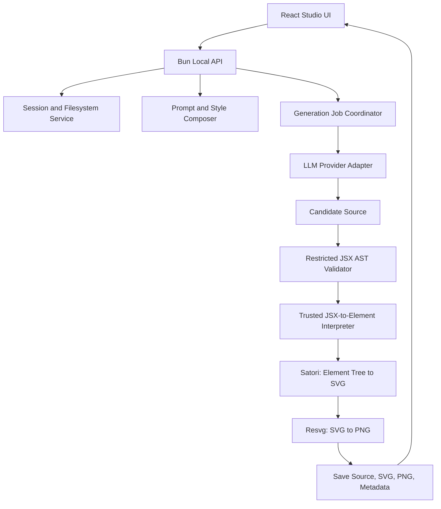

# Renderloom Roadmap

> **Project:** Renderloom  
> **Purpose:** A local-first, code-first AI image design studio that turns natural-language prompts into editable JSX compositions, renders them through Satori and Resvg, and keeps every design iteration inside a persistent session.

This roadmap is the implementation source of truth for the MVP. Work through the phases in order unless a dependency requires a change. Keep completed work checked, do not mark a phase complete until its acceptance criteria pass, and record implementation decisions or deviations in `LOG.md`.

## 1. Product Definition

### 1.1 Vision

Renderloom lets a user describe a visual, select a design style, choose output dimensions and quantity, and use their own cloud LLM API credentials to generate editable designs. The output is reproducible code and local image files rather than an opaque raster-only result.

Core workflow:

1. Create or open a session.
2. Enter a design prompt and choose a style preset.
3. Configure candidate count, aspect ratio, and exact dimensions.
4. Select an LLM provider and model, then supply a personal API key.
5. Generate multiple independent JSX candidates.
6. Validate each candidate without executing arbitrary model-generated JavaScript.
7. Render each valid candidate with Satori to SVG and `@resvg/resvg-js` to PNG.
8. Review the images, inspect their JSX source, and request revisions in the same session.
9. Save all source, intermediate artifacts, final images, prompt context, and version history locally.
10. Close the app and later reopen the session with its context and results restored.

### 1.2 Product principles

- **Local-first:** sessions and generated artifacts stay on the user's local filesystem.
- **Bring Your Own Key (BYOK):** users supply credentials for their chosen provider; Renderloom does not proxy requests through a Renderloom-owned key.
- **Code-first:** every design is represented by inspectable, versioned source code.
- **Deterministic rendering:** image rendering is performed by Renderloom, not delegated to the LLM.
- **Safe by construction:** model output is untrusted data and must not be executed as unrestricted JavaScript.
- **Recoverable:** completed candidates and prior versions remain available even when another candidate fails.
- **Incremental:** the MVP prioritizes one reliable path from prompt to saved PNG before advanced editing features.

### 1.3 MVP scope

The MVP includes:

- A local web UI served by a Bun-based TypeScript application.
- Provider, model, and API-key settings for supported cloud LLM APIs.
- An editable project-level `prompt.txt` with system-level technical constraints kept separate.
- Built-in style presets and the ability to select a preset for each generation.
- Candidate count, aspect-ratio presets, and custom width/height controls.
- Generation progress and per-candidate status.
- Restricted JSX parsing/validation and rendering through Satori and Resvg.
- PNG preview, JSX source inspection, and SVG inspection/download.
- Same-session revision with immutable version history.
- Local session history and restore.
- Local filesystem persistence under `Outputs/<session-name>/`.
- Logging, validation, error handling, and automated tests that verify the core flow.

### 1.4 Explicit non-goals for the first MVP

Do not block MVP completion on these features:

- Image generation from a diffusion model or text-to-image model. Renderloom's primary renderer builds graphics from code. Optional AI-generated photographic assets can be explored later.
- A full drag-and-drop vector editor or freeform canvas editor.
- Team collaboration, cloud sync, accounts, or hosted multi-user deployment.
- A plugin marketplace or user-installed executable components.
- Video generation or a timeline editor.
- Direct publishing to social platforms.
- Automatic visual-quality scoring as a mandatory step.
- Advanced asset search, stock-library integration, or arbitrary remote image fetching.

## 2. Proposed Technical Baseline

Choose minimal, maintainable dependencies. Confirm versions and runtime compatibility when creating the initial project; pin lockfile versions and do not upgrade major dependencies without tests.

- **Runtime/package manager:** Bun.
- **Language:** TypeScript with strict type checking.
- **Frontend:** React + TypeScript, preferably Vite for a lightweight local web application.
- **Local API:** Bun HTTP server or a small compatible routing layer. Avoid a large framework unless it clearly reduces complexity.
- **Image layout/rendering:** `satori` for JSX-like static element layout to SVG.
- **SVG rasterization:** `@resvg/resvg-js` for SVG to PNG.
- **JSX parsing:** a maintained AST parser with explicit JSX syntax support, such as the TypeScript compiler API or Babel parser. Choose one and hide it behind a validator module.
- **Session storage:** filesystem-based JSON metadata for the MVP. Evaluate SQLite only if session search, migrations, or indexing becomes difficult.
- **Testing:** Bun test runner for unit/integration tests, plus browser-level end-to-end tests if the chosen frontend setup supports them cleanly.

### 2.1 Important Satori constraint

Satori does not implement a complete browser or all of React/CSS. Treat Satori's supported element and style subset as a hard contract. The system prompt, style presets, validation rules, renderer tests, and examples must use only supported features. Do not assume that arbitrary browser CSS will render identically.

### 2.2 High-level architecture



### 2.3 Trust boundaries

- The frontend is a UI, not the security boundary. Validate request values in the local API.
- The LLM provider response is untrusted input.
- The generated JSX source is data to parse, not code to execute.
- The renderer should receive an approved element tree created by Renderloom's own interpreter.
- Generated code must not have access to filesystem APIs, environment variables, process APIs, dynamic imports, network requests, or arbitrary JavaScript execution.
- Remote resource URLs emitted by the LLM must not be fetched automatically. Images should come from explicitly selected local assets or a controlled asset-import flow.
- If future requirements force dynamic code execution, use a separate OS-level sandbox with restricted filesystem and network access. Do not treat `eval`, `new Function`, a VM context, or a worker thread alone as a sufficient security sandbox.

## 3. Local Project and Output Structure

Keep application source code separate from generated session data. The following is a target layout; adapt source folders to the chosen tooling without changing the user-facing output contract.

```text
renderloom/
├── prompt.txt
├── style-presets/
│   ├── bauhaus.json
│   ├── swiss.json
│   ├── minimal.json
│   ├── editorial.json
│   └── brutalist.json
├── src/
│   ├── app/                  # Frontend entry and UI
│   ├── components/           # UI components
│   ├── server/               # Bun API and request validation
│   ├── domain/               # Session, generation and version types
│   ├── llm/                  # Provider interface and adapters
│   ├── prompts/              # Prompt composition and output contract
│   ├── styles/               # Preset validation and resolution
│   ├── renderer/             # JSX AST validation/interpreter, Satori, Resvg
│   ├── sessions/             # Session service and filesystem persistence
│   ├── jobs/                 # Per-candidate jobs and progress
│   ├── security/             # Secret redaction and input limits
│   └── shared/               # Shared contracts and utilities
├── tests/
├── Outputs/
│   └── <session-name>/
│       ├── session.json
│       ├── prompt.snapshot.txt
│       ├── conversation.json
│       ├── generation-config.json
│       ├── images/
│       │   ├── design-001-v001.png
│       │   └── design-001-v002.png
│       ├── source/
│       │   ├── design-001-v001.jsx
│       │   └── design-001-v002.jsx
│       ├── svg/
│       │   ├── design-001-v001.svg
│       │   └── design-001-v002.svg
│       ├── assets/            # Explicitly imported session-local assets
│       └── logs/              # Optional sanitized session events only
├── ROADMAP.md
├── LOG.md
├── README.md
├── package.json
└── bun.lock
```

### 3.1 Output and persistence rules

- Session files live under `Outputs/<safe-session-slug>/`.
- `session.json` stores the session ID, display name, timestamps, candidate/version metadata, selected provider name/model ID, style ID and version, dimensions, and artifact paths. It must not contain API keys.
- `prompt.snapshot.txt` records the content of `prompt.txt` used at session creation or at generation time. Preserve a snapshot for reproducibility even if the global prompt later changes.
- `conversation.json` contains user instructions, assistant responses relevant to the design process, references to candidates, and revision history. It must never contain API keys or authorization headers.
- `generation-config.json` records safe settings for each generation: provider ID, model ID, style and style version, candidate count, width, height, format, and timestamps. Do not store credential values.
- `images/`, `source/`, and `svg/` store artifacts with stable candidate IDs and immutable version numbers.
- Write files atomically: write to a temporary file, flush/close it, and rename into place where supported. Avoid corrupting an existing session on a crash.
- Never overwrite an artifact from a completed version. A revision creates a new version.
- Sanitize session names and generated filenames. Resolve paths against the canonical `Outputs` directory and reject traversal, absolute-path injection, and symlink escapes.
- Do not expose the `Outputs` directory as an unrestricted static web root. Provide controlled API routes for listing, previewing, and downloading only known session artifacts.
- Do not store API keys in any output folder, source file, prompt snapshot, conversation, generated JSX, error message, or application log.

## 4. Core Data Contracts

Prefer explicit, versioned TypeScript types and runtime schema validation. The following is a conceptual contract; refine exact fields during implementation and keep serialized formats backward-compatible.

### 4.1 Generation request

```ts
type GenerationRequest = {
  sessionId: string;
  prompt: string;
  styleId: string;
  candidateCount: number;
  width: number;
  height: number;
  outputFormat: "png";
  providerId: string;
  modelId: string;
  // Credential is supplied separately and is never persisted in this object.
};
```

### 4.2 Candidate lifecycle

```text
queued -> generating -> validating -> rendering -> completed
                         |                 |
                         +-> failed        +-> failed

queued/generating -> cancelled
```

Each candidate must have its own state, error summary, timing information, source version, and artifact references. A failure in one candidate must not change the status or delete artifacts of another candidate.

### 4.3 Session, candidate and version identities

- A **session** groups a design task, initial prompt, conversation, candidates, and revisions.
- A **candidate** is an independent design branch in that session.
- A **version** is an immutable iteration of a specific candidate.
- Every version points to its parent version when created by revision.
- A selected candidate can be revised repeatedly without creating a new session.
- Revisions must record the user's change request and the model response metadata that is safe to persist. Never persist provider request headers or credentials.

## 5. Roadmap Phases

All phases use checklists. A phase is complete only when its tasks and acceptance criteria are verified.

## Phase 0 — Repository Foundation and Product Contracts

**Goal:** Establish a clear, testable project base before implementing the full UI.

- [x] Create the Bun + TypeScript project and lockfile.
- [x] Add strict TypeScript settings and lint/format commands.
- [x] Create the initial React frontend scaffold.
- [x] Establish separate frontend, local API, renderer, LLM, prompt, session, and shared-contract modules.
- [x] Create `ROADMAP.md`, `LOG.md`, and a starter `README.md`.
- [x] Add a safe default `prompt.txt`.
- [x] Define versioned TypeScript interfaces for sessions, candidates, versions, generation requests, and errors.
- [x] Add runtime validation for all requests entering the local API.
- [x] Document supported runtime/platform assumptions and local startup commands.
- [x] Add `.gitignore` rules for runtime secrets, local environment files, temporary render data, test outputs, and user-generated `Outputs/` content when appropriate. Provide a separate safe example session only if needed for screenshots/tests.

**Acceptance criteria**

- The app starts locally using documented Bun commands.
- Type checking and the test command run successfully from a clean checkout.
- No API key or user-generated session data is required to boot the app.
- The architecture boundaries are documented and reflected in the source tree.

## Phase 1 — Rendering Proof of Concept

**Goal:** Prove the core code-to-image pipeline independently of LLM integration.

- [x] Install and pin compatible versions of `satori` and `@resvg/resvg-js`.
- [x] Build a small static JSX fixture that uses only supported Satori elements and styles.
- [x] Parse JSX with an AST parser; reject syntax outside the MVP allowlist.
- [x] Define the first allowed element set, such as `div`, `span`, `p`, and `img`, plus a documented set of supported properties.
- [x] Define safe literal-only value types for text, numbers, colors, dimensions, and inline style values.
- [x] Reject imports, exports other than the agreed source wrapper, function calls, arbitrary identifiers, event handlers, script/style injection, dynamic expressions, JSX spreads, and unapproved attributes.
- [x] Implement a trusted AST-to-element interpreter that creates the element structure supplied to Satori without evaluating the source as JavaScript.
- [x] Configure fonts explicitly and write down licensing and bundling requirements for each shipped font.
- [x] Define an approved asset resolver for local session assets; block automatic fetching of arbitrary URLs.
- [x] Render the fixture to SVG and then PNG.
- [x] Verify final image width and height against the requested dimensions.
- [x] Save the fixture source, SVG, and PNG as test artifacts.
- [x] Add negative tests for malicious or unsupported JSX syntax.

**Acceptance criteria**

- A known-good JSX fixture produces a valid SVG and PNG.
- PNG metadata and pixel dimensions match the requested output.
- Unsupported syntax is rejected before rendering.
- The source is never run through `eval`, `new Function`, unrestricted dynamic import, or another general-purpose JavaScript execution path.
- Renderer errors are returned as structured failures, not process crashes.

## Phase 2 — Local Sessions and Filesystem Persistence

**Goal:** Make the application local-first and able to restore past work.

- [x] Create the `Outputs/` directory when the app first needs it.
- [x] Implement session creation, list, read, rename, and safe deletion flows.
- [x] Generate a collision-safe directory slug from the session name, adding an ID or timestamp when necessary.
- [x] Create the per-session directories `images/`, `source/`, `svg/`, and `assets/`.
- [x] Implement atomic writing for JSON metadata and artifact files.
- [x] Save and load `session.json` with a schema version.
- [x] Save and load `conversation.json` without secret values.
- [x] Save the effective `prompt.txt` snapshot and safe generation configuration for reproducibility.
- [x] Add a recovery path for incomplete sessions, malformed metadata, and orphaned temporary files.
- [x] Add path traversal and symlink-boundary tests for all filesystem operations.
- [x] Ensure the API serves only artifacts belonging to an existing session and never arbitrary filesystem paths.
- [x] Add a session history view sorted by most recent activity.
- [x] Add session reopen behavior that restores candidate state, prompt context, dimensions, and artifact previews.

**Acceptance criteria**

- A session with a generated fixture can be closed and reopened with its data intact.
- Creating sessions with duplicate or hostile names cannot overwrite other sessions or write outside `Outputs/`.
- Corrupt metadata for one session does not prevent the history list from showing other valid sessions.
- No session metadata or transcript contains API keys.

## Phase 3 — LLM Provider and BYOK Configuration

**Goal:** Let users connect their own supported cloud LLM APIs without leaking their credentials.

- [x] Define a provider adapter interface that exposes model selection, key validation where supported, request generation, response normalization, and safe error mapping.
- [x] Implement an initial supported-provider set. At minimum, provide a generic OpenAI-compatible endpoint adapter and document any provider-specific adapters included in the first release.
- [x] Keep provider-specific request and response formats inside their adapters.
- [x] Let the user choose a provider, enter a model ID, and input their API key.
- [x] Support custom base URLs only for explicitly configured OpenAI-compatible endpoints; validate schemes and reject unsupported or unsafe local-network targets where applicable.
- [x] Allow the user to test a provider/model/key combination without generating images.
- [x] Keep the API key in transient application memory by default. Do not save it to `Outputs/`, the conversation, prompt files, source code, browser local storage, analytics, or logs.
- [x] Send credentials only to the local API over the local app's own request path, then use them for the user's explicitly selected provider request. Do not add credentials to URLs.
- [x] Never return the raw key to the frontend after submission; show only a masked indicator and a clear “key is held for this run/session” status.
- [x] Clear the in-memory key when the app session or credential scope ends, and provide a visible “forget key” action.
- [ ] If persistent key storage is added later, require explicit user opt-in and use the operating system credential vault/keychain where available. Do not fall back to plaintext JSON or `.env` storage.
- [x] Redact authorization headers, tokens, API keys, and full credential-bearing provider errors from all logs and UI errors.
- [x] Handle unauthorized keys, insufficient quota, rate limits, unsupported models, timeouts, network errors, and provider outages with actionable but non-sensitive messages.
- [x] Add tests proving that sentinel fake keys never appear in serialized sessions, logs, network error messages, screenshots, or output files.

**Acceptance criteria**

- A user can select a provider and model, supply their own key, and perform a live test request.
- Provider errors are normalized and understandable.
- A key is not persisted unless a separately specified, opt-in credential-vault feature is implemented.
- Automated secret-leak tests pass.

## Phase 4 — Prompt Composer and Style Presets

**Goal:** Turn user intent, custom instructions, style constraints, and output settings into a consistent LLM request.

- [x] Create an editable project-level `prompt.txt` with clear defaults and comments/documentation outside the prompt if necessary.
- [x] Define immutable technical instructions separate from `prompt.txt`; the user's custom prompt must not disable code validation or security rules.
- [x] Snapshot the effective `prompt.txt` content used for every session/generation.
- [x] Define a versioned style-preset schema, including ID, display name, design principles, palette, typography guidance, spacing/layout rules, allowed effects, and patterns to avoid.
- [x] Add built-in presets for Bauhaus, Swiss International Style, Minimal, Editorial, and Brutalist visual design.
- [x] Add a style picker with a short description and visual sample where practical.
- [x] Validate style preset files before exposing them to the generation system.
- [x] Make the selected style's rules concrete and actionable rather than passing only its name to the LLM.
- [x] Add request fields for prompt, candidate count, width, height, aspect ratio, style ID, provider ID, and model ID.
- [x] Support aspect-ratio presets such as 1:1, 4:5, 3:2, and 16:9, plus custom dimensions.
- [x] Derive and display the resolved dimensions when the user selects an aspect ratio.
- [x] Validate maximum width, height, total pixel count, candidate count, prompt length, and asset count to prevent excessive resource usage.
- [x] Create a structured output contract requiring one independently identified candidate source per requested candidate.
- [x] Request concise design metadata separately from source code where possible, such as a candidate label and short rationale.
- [x] Test the composed prompt with fixture responses before involving the renderer.

**Acceptance criteria**

- Changing `prompt.txt` affects subsequent generations without silently changing a session's saved snapshot.
- A style preset injects concrete design guidance into the LLM request.
- Dimensions and candidate count are controlled by validated application data, not inferred from generated source.
- Invalid or oversized requests are rejected before calling the cloud provider.

## Phase 5 — Generation Orchestration and Partial Success

**Goal:** Generate multiple independent designs with visible progress and isolated failures.

- [x] Implement a generation coordinator that creates one tracked job per candidate.
- [x] Use bounded concurrency suitable for a local application; make the limit configurable in code/configuration, not unlimited.
- [x] Give each job a stable candidate ID and record its own status, timings, retries, and error summary.
- [x] Request separate candidate outputs so a single malformed response does not invalidate the whole requested batch.
- [x] Normalize provider output into the structured candidate contract and reject missing or ambiguous source fields.
- [x] Enforce response-size and source-length limits before parsing.
- [x] Validate the generated JSX against the restricted syntax and component/style allowlists.
- [x] Convert accepted JSX AST into the trusted element tree; render with Satori; rasterize the SVG with Resvg.
- [x] Check output dimensions and verify that the PNG is decodable before marking the candidate complete.
- [x] Save successful candidate artifacts immediately, not only after the entire batch completes.
- [x] Continue remaining jobs when one candidate fails.
- [x] Add controlled retries for transient provider or renderer failures, with an upper limit and backoff; do not retry permanent validation failures indefinitely.
- [x] Show live progress and independent statuses: Queued, Generating, Validating, Rendering, Completed, Failed, or Cancelled.
- [x] Allow cancellation of queued jobs and best-effort cancellation of in-flight requests where supported.
- [x] Provide a clear per-candidate retry action without resetting successful candidates.
- [x] Save partial batch results and their errors to session metadata.

**Acceptance criteria**

- Requesting several candidates produces independently tracked outputs.
- If one candidate fails, successful candidates remain reviewable and downloadable.
- A failed job can be retried without overwriting successful results.
- The UI distinguishes partial success from total failure.

## Phase 6 — Review Workspace

**Goal:** Provide the main user experience for inspecting and selecting generated visual designs.

- [x] Build a session workspace with prompt details, generation settings, progress, and result gallery.
- [x] Display candidate thumbnails and generation status.
- [x] Open a selected image in a larger preview.
- [x] Display the candidate's current version and its generation metadata.
- [x] Add a syntax-highlighted, read-only JSX source viewer for the current version.
- [x] Add a read-only SVG source viewer or download action.
- [x] Add download actions for PNG, SVG, and JSX source.
- [x] Ensure preview routes resolve only assets from the selected session and candidate.
- [x] Surface useful validation/render errors for failed candidates without exposing secrets or sensitive provider request details.
- [x] Add empty states for a new session, a running generation, no successful candidates, and an unavailable artifact.
- [x] Keep layout and keyboard navigation usable at common desktop screen widths.
- [x] Add loading states and avoid blocking the entire UI while candidate jobs are running.

**Acceptance criteria**

- The user can identify, preview, inspect, and download each completed candidate.
- A candidate's displayed code always corresponds to the exact image version being previewed.
- UI errors are helpful while sanitized.

## Phase 7 — In-Session Revisions and Immutable Version History

**Goal:** Let users modify a design by natural-language instruction without leaving the session or losing previous work.

- [ ] Add a revision prompt for the currently selected candidate.
- [ ] Send the revision request with the selected candidate's current JSX, the session's relevant conversation context, the effective style constraints, and output dimensions.
- [ ] Keep the revision context bounded; do not blindly include every artifact or the entire history when unnecessary.
- [ ] Let the model modify the selected candidate rather than replacing unrelated candidates.
- [ ] Run every revised source through exactly the same validation and render pipeline as an initial generation.
- [ ] Create a new immutable version after a revision succeeds; never overwrite the previous source, SVG, or PNG.
- [ ] Record the parent version ID, revision instruction, timestamp, and safe model metadata.
- [ ] Display version history with preview, source, and restore/branch actions.
- [ ] Implement “restore” by selecting an existing version or branching from it; do not delete later versions implicitly.
- [ ] Preserve the original prompt and prompt snapshot while recording the revision prompt separately.
- [ ] Keep revision failures visible and retain the last successful version as the current usable design.
- [ ] Allow more than one revision within the same session and persist the full revision chain.

**Acceptance criteria**

- A user can revise a candidate without creating another session.
- The previous successful version stays accessible after each successful revision.
- A failed revision does not replace the current successful version.
- Reopening the session restores its revision conversation and version tree.

## Phase 8 — Reliability, Security and Automated Verification

**Goal:** Test failure paths, enforce resource limits, and reduce risk before declaring the MVP ready.

- [ ] Add unit tests for request schemas, style loading, prompt composition, file naming, path containment, metadata serialization, and secret redaction.
- [ ] Add renderer tests for approved JSX elements, supported styles, font loading, images, SVG generation, PNG generation, and dimension checks.
- [ ] Add malicious-source tests for imports, `eval`, `Function`, dynamic imports, arbitrary property access, event handlers, script tags, JSX spreads, dangerous URL attributes, filesystem/network references, and oversized ASTs.
- [ ] Add tests that generated JSX is parsed and interpreted as data and is never evaluated as general JavaScript.
- [ ] Add integration tests with a fake LLM provider; normal development/test runs must not require paid API usage.
- [ ] Add a live-provider smoke test that runs only when explicitly configured by the developer.
- [ ] Test one success and one failure in the same batch to prove partial success is preserved.
- [ ] Test retry, cancellation, provider rate-limit responses, timeouts, malformed output, and renderer errors.
- [ ] Test restart/reopen after completed, failed, and interrupted generation jobs.
- [ ] Test disk-full or write-permission failures and ensure existing artifacts remain intact.
- [ ] Add limits for prompt text length, model output length, candidate count, dimensions, pixel count, asset bytes, SVG bytes, and render duration.
- [ ] Do not fetch arbitrary remote URLs found in generated JSX. If remote asset import is introduced later, require explicit user action, validate the URL and content type, cap response size, prevent local-network access, and define timeout behavior.
- [ ] Use structured logging for event type, job ID, candidate ID, stage, and sanitized error code.
- [ ] Never log API keys, authorization headers, raw credential-bearing payloads, or unfiltered provider error bodies.
- [ ] Add dependency/license review for shipped fonts and runtime packages.
- [ ] Run formatting, lint, type checking, test suite, and production build as release gates.

**Acceptance criteria**

- Core success and failure paths are covered by automated tests.
- A malicious or unsupported source is rejected without arbitrary code execution.
- One failed candidate does not remove successful candidate files.
- Secret-leak tests pass using sentinel credentials.
- Existing session data survives interrupted writes as far as the filesystem contract allows.

## Phase 9 — Documentation and MVP Release

**Goal:** Make Renderloom usable by a developer who has cloned the repository for the first time.

- [ ] Write the README project summary, feature list, screenshots, architecture overview, and a short demo workflow.
- [ ] Document prerequisites, Bun installation, dependency installation, development mode, tests, and production build commands.
- [ ] Document every supported LLM provider, model-ID entry behavior, key validation limitations, and known provider-specific differences.
- [ ] Explain BYOK handling, default in-memory credential lifetime, the fact that keys are not saved in session output, and how to clear a key.
- [ ] Document supported JSX elements and styles, validation restrictions, and known Satori limitations.
- [ ] Document how to customize `prompt.txt` and create or edit style presets.
- [ ] Document the `Outputs/<session-name>/` directory and meaning of each saved artifact.
- [ ] Add a sample session with non-sensitive images/source suitable for documentation, or provide a reliable way to generate one.
- [ ] Add license files and third-party notices as appropriate, especially for included fonts and assets.
- [ ] Add issue templates or a bug-report checklist if the repository is open to contributions.
- [ ] Verify that a clean clone can install, start, test, generate a fixture, and reopen a sample session using the documented steps.
- [ ] Tag the first MVP release only after all required checks below pass.

**Acceptance criteria**

- A new developer can start Renderloom by following the README without undocumented manual setup.
- The docs accurately describe the current features and security limitations.
- Release checks pass from a clean checkout.

## 6. Required MVP Completion Checklist

These ten requirements are release-blocking. Keep this checklist in sync with the phase checklists above.

- [ ] Pengguna dapat memilih provider, model, dan memasukkan API key sendiri.
- [ ] Pengguna dapat mengubah prompt.txt dan memilih style preset.
- [ ] Pengguna dapat mengatur jumlah gambar, aspect ratio, dan dimensi output.
- [ ] LLM menghasilkan JSX yang lolos validasi dan dapat dirender menjadi PNG.
- [ ] Setiap hasil dapat direview, dan source JSX dapat diperiksa.
- [ ] Pengguna dapat merevisi gambar tanpa meninggalkan sesi.
- [ ] Setiap revisi menjadi versi baru tanpa menghapus versi sebelumnya.
- [ ] Session dapat ditutup lalu dibuka kembali dengan konteks dan hasil yang utuh.
- [ ] Kegagalan satu kandidat tidak menghilangkan hasil kandidat lainnya.
- [ ] API key tidak disimpan ke folder output, percakapan, atau log.

### 6.1 Definition of Done for MVP

The MVP is done only when all ten requirements above pass manual verification and relevant automated tests. A feature should not be considered complete merely because its UI exists; the persisted output, error path, and acceptance criteria must also work.

## 7. Post-MVP Opportunities

These are optional follow-up ideas and must not delay the first usable release.

- [ ] Add more provider adapters and a provider capability matrix.
- [ ] Add opt-in OS credential-vault integration where supported.
- [ ] Add user-defined style presets and a preset browser.
- [ ] Add local asset library and explicit image import workflows.
- [ ] Add visual comparison between versions and side-by-side candidate review.
- [ ] Add controlled repair prompts when a model repeatedly emits invalid JSX.
- [ ] Add optional vision-model critique and suggested revisions.
- [ ] Add SVG cleanup, optimization, and additional export formats where reliable.
- [ ] Add batch export, contact sheets, and ZIP export of session artifacts.
- [ ] Add configurable cost estimates, token usage summaries, and per-session usage reports using provider-reported data when available.
- [ ] Add keyboard shortcuts and advanced workspace layout.
- [ ] Evaluate SQLite for faster session indexing if JSON metadata scanning no longer meets requirements.
- [ ] Evaluate a stronger OS-level sandbox if future features require dynamic code execution or third-party plugins.
- [ ] Add optional AI-generated photo/illustration assets as a separate capability, clearly distinguished from code-rendered graphics.

## 8. Development Workflow

- Implement one phase or a small vertical slice at a time.
- Before changing a phase's scope, update this roadmap and record the reason in `LOG.md`.
- Add a regression test when fixing a bug.
- Keep generated artifacts out of source control by default, except for small, non-sensitive fixtures intentionally used by tests or documentation.
- Never use a real API key in fixtures, tests, screenshots, sample sessions, or bug reports.
- Use fake provider responses for repeatable tests. Live calls should be opt-in and should not be part of the required test suite.
- Keep the UI, provider adapter, prompt composer, validator, and renderer independently testable.
- Treat a failed render or failed revision as a recoverable per-candidate condition, not a reason to discard an entire session.
- When using a coding agent, work from the topmost incomplete phase and preserve completed checkboxes. Do not mark a task complete without verifying the corresponding behavior.

## 9. External Technical References

Verify current APIs and supported syntax during implementation; these links provide the primary technical references used to define this roadmap.

- [Satori — official repository and supported JSX/CSS subset](https://github.com/vercel/satori)
- [resvg-js — official repository and SVG-to-PNG rendering](https://github.com/thx/resvg-js)
- [Bun — SQLite documentation](https://bun.com/docs/runtime/sqlite)
- [Bun — environment variables documentation](https://bun.sh/docs/runtime/environment-variables)
- [OWASP — Secrets Management Cheat Sheet](https://cheatsheetseries.owasp.org/cheatsheets/Secrets_Management_Cheat_Sheet.html)
- [OWASP — Logging Cheat Sheet](https://cheatsheetseries.owasp.org/cheatsheets/Logging_Cheat_Sheet.html)

---

**Roadmap status:** Planning complete; implementation has not been verified by this document. Checkboxes represent work to be completed, not claims that the features already exist.
